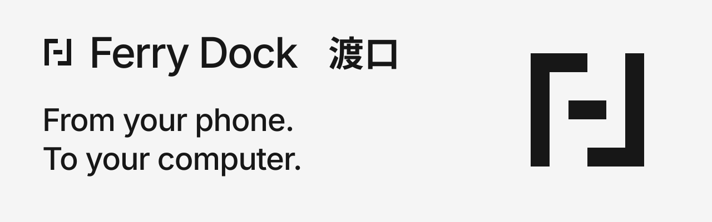

# Ferry Dock

<picture>
  <source media="(prefers-color-scheme: dark)" srcset="brand/banner-dark.svg">
  
</picture>

**A small local bridge from your phone to your computer.**

[简体中文](README.zh-CN.md) · [Product FAQ](PRFAQ.md) · [Distribution](docs/distribution.md) · [Brand assets](brand/README.md)

Bring phone text into a temporary computer inbox, or into the task that asked for it. Open the computer page, scan, paste, and send. Ordinary transfer needs no AI component or phone app.

**Local preview:** `0.1.0-alpha.1` packages are being validated locally. The intended user path is a prebuilt macOS app or native CLI archive, without Git, Go, or Node installation. There is **no published GitHub Release or public download URL yet**; local package evidence and availability are recorded in [distribution](docs/distribution.md). Source building is for contributors.

## Comments on your phone, proposal on your computer

You are drafting a proposal on the computer, but the client's comments are in a phone chat. Send them to the computer and copy them into your work.

For an Agent-assisted task, create a request naming the proposal and missing feedback. Its phone page asks that question; a private reader handle returns only that request's result. Another task's answer is not an undifferentiated “latest message” to guess from.

The request loop is a transfer tool, not an Agent host. A timed-out wait can be queried again; the Skill cannot wake a paused host.

## Open the local preview

The `.app` is Ferry Dock itself, not another desktop platform to install. **First use:** extract the ZIP, open `Ferry Dock.app`, then scan the QR. **Later:** open the app and scan. It runs the same Go core as the CLI and opens the system browser; there is no installation wizard, registration, login item, extra Go/Node platform, source checkout, or global PATH change.

1. The computer page creates a temporary session and shows its QR.
2. Scan with your phone, paste text, and tap **Send to computer**.
3. Click **Copy** on the computer.

Default desktop LAN mode listens on all IPv4 interfaces at a free port and uses a selected private IPv4 address in phone links. If it cannot select an unambiguous LAN address, it falls back to a loopback listener and the page reports **Local only**; a physical phone cannot use loopback. A QR does not bypass guest Wi-Fi isolation, a VPN, routing, or a firewall.

Closing the browser tab keeps the Go service running. Reopening the app returns to its verified instance. Use **Quit Ferry Dock** on the local computer page to stop it; quitting clears **every** in-memory session and request. Private cache directories or `startup.log` may remain. Cancel only your own request when other tasks share the service.

A local bundle is not a signed/notarized public release or proof of downloaded-file Gatekeeper acceptance. [Distribution](docs/distribution.md) separates artifact generation, native checks, first-launch acceptance, and publication. No security bypass is part of this preview.

## Prefer a CLI?

Extract the native archive for your OS/architecture. From its package root in a macOS/Linux POSIX shell:

```sh
./ferry-dock version
./ferry-dock desktop
```

Windows uses `.\ferry-dock.exe` in PowerShell. Archive creation or cross-compilation does not establish native execution on every platform. The CLI defaults to foreground `serve` if run with no subcommand; use `desktop` explicitly for the browser launcher/background lifecycle.

Both the CLI and app executable support JSON `version` and `request` commands. Version output includes `version`, `commit`, `os`, `arch`, and `defaultMode`. See [distribution](docs/distribution.md) for package layout and advanced `serve --listen ... --public-url ...` use.

## Ordinary transfer stays simple

Keep sending from the same phone page without rescanning. **End session** clears that session; **New session** creates another. Sessions expire after 15 minutes by default. Closing a browser is different from ending a session or quitting the service.

Ordinary text is limited to 64 KiB per message, 1 MiB and 128 messages per session, with at most 16 active sessions. Accepted text preserves whitespace and Unicode. A receipt means the service accepted it, not that a person has viewed or copied it.

## Task collection: request, wait, read

Use an already running desktop instance and its private control path. On macOS the default is `~/Library/Caches/ferry-dock/runtime/control.json`; `desktop` also returns `controlPath`. Do not print the file: it contains process management authority.

Set `ferry_bin` to the **absolute** prebuilt executable path. For an app this is `Ferry Dock.app/Contents/MacOS/ferry-dock`; for a native archive it is the extracted `ferry-dock`. The following POSIX example assumes the desktop instance is ready and uses a new private directory:

```sh
ferry_bin="/absolute/path/to/ferry-dock"
control_path="$HOME/Library/Caches/ferry-dock/runtime/control.json"
umask 077
runtime_dir="$(mktemp -d)"
"$ferry_bin" version
"$ferry_bin" request create \
  --control "$control_path" \
  --task-id proposal-launch \
  --prompt "Launch proposal: paste the changes from your phone chat." \
  --handle "$runtime_dir/proposal.json" --ttl 15m --max-bytes 16384
```

Use your actual executable/control paths, including any custom desktop `--state-dir`. Each request requires a fresh handle and default PNG path. Windows users need a user-private directory, Windows paths, and PowerShell syntax; these are POSIX examples.

Show the returned QR PNG or private phone URL in the requesting conversation. Creation output contains no process computer token or reader token; the handle still contains request-scoped authority and must stay private.

After the phone submits, wait and read through the same handle. Before submission these can correctly return pending/no input:

```sh
"$ferry_bin" request wait --handle "$runtime_dir/proposal.json" --timeout 10s
"$ferry_bin" request read --handle "$runtime_dir/proposal.json"
```

A request accepts one response, at most 16 KiB by default. `--ttl` accepts whole-second durations such as `15m` or `900s`; omission inherits service retention. The server assigns `requestId`; `taskId` is correlation metadata, never permission. Independent reader and sender capabilities are bound to that request.

Use `request status --handle ...` to inspect state and `request cancel --handle ...` to end collection. A wait is at most ten seconds. Timeout returns pending without canceling, and Ctrl+C during `request wait` ends only the wait. This guarantee does not apply to interrupted create/cancel mutations; `outcome_unknown` requires reconciliation, not blind retries.

Reads return stable `input.id` and `trust: "untrusted_user_input"`. The consumer must validate request/task identity and skip already completed business effects for the same input. If an edit's outcome is uncertain, inspect the artifact before retrying. Exactly-once Agent execution is not promised.

The optional [local Skill](skills/ferry-dock/SKILL.md) is bundled with native archives and in the app's `Contents/Resources/skills/`. Reference it manually; it does not install global configuration, require a source checkout, or turn phone text into executable instructions.

## One Go core, explicit trust

The app launcher, standalone CLI, browser pages, and request adapter share one Go core. The app is a packaging/default-mode choice, not another Swift/Node backend. See [architecture](docs/architecture.md), [request v1](docs/contracts/request-v1.md), and [runtime decision](docs/decisions/0001-runtime.md).

**Local does not mean encrypted.** Desktop mode may listen for phone traffic on a selected trusted LAN; foreground `serve` defaults to loopback unless configured. This preview has no TLS provisioning or end-to-end encryption. Network observers may obtain content and bearer capabilities. Keep computer links, control files, reader handles, and phone invitations private. Do not expose it directly to the Internet.

Local operation/no model call describe the Ferry Dock service. Once the optional Skill supplies a CLI result to an Agent, cloud-model transmission and retention depend on that host. Ordinary non-AI transfer still requires no AI account.

## Limits and recovery

| Situation | What to do |
| --- | --- |
| Page reports Local only | A phone cannot reach loopback. Use a verified LAN origin through advanced configuration; do not disable network protections. |
| Browser tab was closed | Reopen the app. The service continues until **Quit Ferry Dock** or process exit. |
| Service is ready but browser opening failed | Retry reopening or use its known private control path. A browser-open error does not undo service startup. |
| Paste or Copy is unavailable | Use manual system paste or select the visible text to copy. Browser permissions vary. |
| Wait returns pending | Keep the handle and query again; timeout did not cancel collection. |
| Create/cancel returns `outcome_unknown` | Query through the saved handle. If creation saved none, report uncertainty and let the unknown request expire rather than blindly recreating. |
| Desktop reports an unknown service | Its identity was not verified. Do not kill it or overwrite shared state to force a launch. |
| Service quit/restarted | Old in-memory content is gone; handles are not backups. |

Files, photos, audio, remote phone control, continuous clipboard sync, durable history, cloud relay, npm/npx, MCP, and a browser plugin are not included. [Product shape](docs/product-shape.md) records the narrow scope.

## Evidence and contributing

Real Safari 27.0.1 loopback checks passed for ordinary transfer, actual system copy/paste, task submission and repeat-read flow, a 390×844 responsive-layout sample, and UI Quit. A fresh-binary follow-up passed same-tab A→B invitation switching without cross-request delivery. This is desktop-browser evidence, not Finder/default-browser auto-opening, physical-phone/LAN/QR-scan, Gatekeeper, or actual Codex-host acceptance. Those remain **NOT_RUN**. Final packaged-artifact validation is separate in [distribution](docs/distribution.md), [verification](docs/verification.md), and [claims/evidence](docs/claims-evidence.md).

The [earlier macOS arm64 / Go 1.27.3 loopback baseline](docs/performance-baseline.md) and [raw samples](docs/benchmarks/2026-10-28-macos-arm64.json) measure a specific prior CLI/core binary, not app launch, browser opening, mobile interaction, or Agent speed. [Budgets](docs/performance.md) remain engineering targets.

<details>
<summary>For contributors: build from source</summary>

Git and Go 1.26+ are developer prerequisites, not preview-user runtime requirements. Start from the source revision matching the preview's manifest; a local preview may be ahead of public `main`. Building/fetching dependencies may need the Internet. From that checkout in a macOS/Linux POSIX shell:

```sh
go build -o bin/ferry-dock ./cmd/ferry-dock
./bin/ferry-dock version
./bin/ferry-dock desktop
```

Windows developers should build `bin/ferry-dock.exe` and invoke `.\bin\ferry-dock.exe`. Source builds report development metadata unless build flags provide a release identity; the packaging script records dirty source explicitly.

```sh
go fmt ./...
go vet ./...
go test ./...
go test -race ./...
```

See [CONTRIBUTING.md](CONTRIBUTING.md) and [the packaging guide](docs/distribution.md).

</details>

The design considered [DropLocal](https://github.com/shiyuanhai/droplocal/tree/16c9fe05e048b2c5ebbe2e75ccb4619620bd9653) for local launch/QR and [Ferry](https://github.com/max1874/ferry/tree/5b7882947ef34ae422004ae81ccc2da509693fe1) for fidelity/incremental retrieval. This application is a new implementation; [third-party notices](THIRD_PARTY_NOTICES.md) retain dependency attribution.

[MIT](LICENSE).
